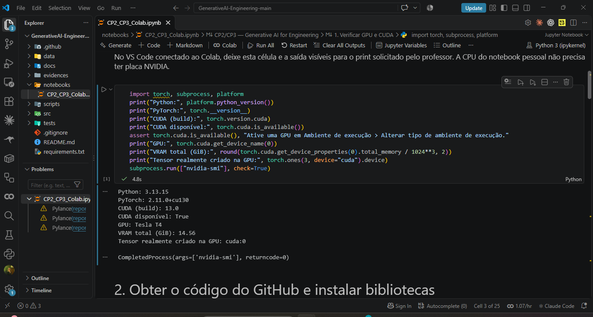
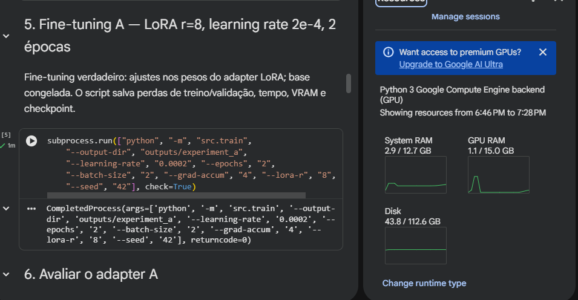

# CP2/CP3 — Generative AI for Engineering

**Projeto:** Python Debug LLM  
**Disciplina:** Generative AI for Engineering  
**Professor:** Francisco Elanio  
**Turma:** 4ESPX  
**Data da entrega:** 15/10/2026

## Integrantes

| Nome completo | RM |
|---|---|
| Guilherme Silva dos Santos | 551168 |
| Enricco Rossi de Souza Carvalho Miranda | 551717 |
| Gabriel Marquez Trevisan | 99227 |
| Danilo Urze Aldred | 99465 |
| Laura Claro Mathias | 98747 |

## Execução com GPU no VS Code

O desenvolvimento e os testes foram realizados com uma **NVIDIA Tesla T4** disponibilizada pelo Google Colab. O notebook também foi executado a partir do VS Code, conectado ao ambiente com GPU.



[Ver a captura em tamanho original](evidences/screenshots/10_gpu_vscode_tesla_t4.webp) · [Informações da GPU (JSON)](evidences/gpu.json)

Na execução, o PyTorch identificou **CUDA disponível**, a **Tesla T4** e aproximadamente **14,56 GiB de VRAM**. Um tensor foi alocado em `cuda:0`. A GPU é remota, fornecida pelo Colab; não faz parte do hardware do notebook pessoal.

## Sobre o projeto

O Python Debug LLM é um assistente voltado ao **diagnóstico de erros em códigos Python**. A aplicação recebe o código, a mensagem de erro e uma descrição do problema. Em seguida, gera uma resposta em português organizada em três partes: **causa**, **correção** e **código corrigido**.

Escolhemos a **[Qwen2.5-0.5B-Instruct](https://huggingface.co/Qwen/Qwen2.5-0.5B-Instruct)** por ser um modelo aberto e relativamente leve, adequado aos recursos disponíveis no Google Colab gratuito. Fizemos um ajuste fino supervisionado com **LoRA**, comparando duas configurações de hiperparâmetros com a versão original da LLM.

### Exemplo de uso

**Entrada:**

```python
print(total)
# NameError: name 'total' is not defined
```

**Saída esperada:**

```text
Causa: a variável total está sendo utilizada antes de ser definida.
Correção: definir um valor para total antes da chamada do print.
```

```python
total = 10
print(total)
```

## Tecnologias utilizadas

| Parte do projeto | Ferramentas |
|---|---|
| Modelo de linguagem | Qwen2.5-0.5B-Instruct |
| Fine-tuning | Python, PyTorch, Transformers, PEFT/LoRA |
| Hardware de treinamento | NVIDIA Tesla T4 (Google Colab) |
| Frontend | Gradio |
| Avaliação e gráficos | Python, Pandas, Matplotlib |
| Versionamento e verificações | GitHub e GitHub Actions |

O modelo roda diretamente no processo Python do ambiente Colab, sem depender de uma API comercial para gerar as respostas.

## Dataset

Criamos uma base com **128 exemplos sintéticos** de erros Python, distribuídos da seguinte forma:

| Conjunto | Quantidade | Finalidade |
|---|---:|---|
| [Treinamento](data/train.jsonl) | 96 | Ajustar os parâmetros LoRA |
| [Validação](data/val.jsonl) | 16 | Acompanhar o treinamento e selecionar checkpoints |
| [Teste](data/test.jsonl) | 16 | Comparar os modelos usando perguntas reservadas |

Os exemplos abrangem problemas como `NameError`, `TypeError`, `IndexError`, `KeyError`, `ValueError`, `ZeroDivisionError` e outros erros comuns. O dataset foi criado para o escopo da atividade; os padrões entre os conjuntos são semelhantes, o que limita a avaliação de generalização para novos cenários.

## Treinamento e hiperparâmetros

Foram feitos dois experimentos de fine-tuning LoRA com a mesma base de treinamento e seed 42:

| Configuração | Learning rate | Épocas | LoRA rank | Batch size | Acúmulo |
|---|---:|---:|---:|---:|---:|
| Modelo original | — | — | — | — | — |
| Experimento A | 0.0002 | 2 | 8 | 2 | 4 |
| Experimento B | 0.00005 | 3 | 16 | 2 | 4 |

Os treinamentos foram executados na Tesla T4, com duração registrada de **56,87 s** para A e **91,37 s** para B. Os detalhes dos treinos estão em [A](evidences/experiment_a_training.json) e [B](evidences/experiment_b_training.json); os gráficos de perda estão na pasta [evidences](evidences/).

## Avaliação dos modelos

Os três modelos responderam às mesmas **16 perguntas de teste**, com temperatura igual a zero na avaliação automatizada. As métricas principais foram:

| Métrica | Original | LoRA A | LoRA B |
|---|---:|---:|---:|
| Respostas com o formato solicitado | 43,75% | 100% | 100% |
| Recall médio de palavras-chave | 75% | 68,75% | 75% |
| Respostas com todos os termos esperados | 56,25% | 50% | 62,5% |


Os dois modelos ajustados passaram a seguir melhor o formato de resposta solicitado. Por outro lado, **as métricas de palavras-chave não demonstram uma melhoria consistente na qualidade técnica das correções**. A análise de respostas identificou erros em alguns casos, como `IndexError` e `AttributeError`.

Isso mostra a importância de combinar métricas automáticas com a leitura do código gerado. A avaliação detalhada, incluindo exemplos de acertos e falhas, está em [Resultados dos experimentos](docs/RESULTADOS_REAIS.md).

## Interface Gradio

O frontend permite informar um erro Python, ajustar a temperatura e o limite de tokens e conversar com a LLM. Também é possível alternar entre o modelo original e o modelo ajustado, quando o adaptador LoRA está disponível.

| Interface com resposta | Treinamento no Colab |
|---|---|
|  |  |

[Mais capturas da aplicação e dos experimentos](evidences/screenshots/)

## Como executar

O fluxo completo está no notebook:

**[Abrir o CP2/CP3 no Google Colab](https://colab.research.google.com/github/GuilhermeSSantos2004/GenerativeAI-Engineering/blob/main/notebooks/CP2_CP3_Colab.ipynb)**

1. Abra o notebook e selecione um ambiente de execução com **GPU**.
2. Execute as células na sequência: verificação CUDA, instalação das dependências, avaliação do modelo original e treinamentos A e B.
3. Compare as respostas, gere os gráficos e salve os resultados.
4. Execute a última célula para iniciar o frontend Gradio. O link público gerado é temporário.

Para executar os scripts a partir do terminal de um ambiente com GPU CUDA e PyTorch configurados:

```bash
python -m pip install -r requirements.txt
python -m pytest -q tests
python scripts/check_gpu.py --output results/gpu.json

python -m src.evaluate --output results/baseline.json

python -m src.train --output-dir outputs/experiment_a --learning-rate 0.0002 --epochs 2 --lora-r 8
python -m src.evaluate --adapter outputs/experiment_a/final_adapter --output results/experiment_a.json

python -m src.train --output-dir outputs/experiment_b --learning-rate 0.00005 --epochs 3 --lora-r 16
python -m src.evaluate --adapter outputs/experiment_b/final_adapter --output results/experiment_b.json

python -m src.report --inputs results/baseline.json results/experiment_a.json results/experiment_b.json
python -m src.ui --adapter outputs/experiment_a/final_adapter
```

No Google Colab, o Gradio pode ser aberto diretamente pela última célula do notebook. As GPUs do plano gratuito estão sujeitas à disponibilidade.

## Organização do repositório

```text
GenerativeAI-Engineering/
├── data/             # Treinamento, validação e teste
├── notebooks/        # Execução completa no Google Colab
├── src/              # Treinamento LoRA, avaliação e interface Gradio
├── scripts/          # Verificação da GPU e exportação de relatórios
├── tests/            # Testes de integridade dos dados
├── evidences/        # Métricas, respostas, gráficos e capturas
├── docs/             # Metodologia e documentação da atividade
├── requirements.txt
└── README.md
```

## Documentação

- [Metodologia e configuração dos experimentos](docs/METODOLOGIA.md)
- [Resultados e análise das respostas](docs/RESULTADOS_REAIS.md)
- [Evidências e capturas de tela](evidences/README.md)
- [Guia de execução no Colab e no VS Code](docs/EXECUCAO.md)
- [Checklist da atividade](docs/ENTREGA.md)
- [Integrantes e RMs](docs/GRUPO.md)

O código, o dataset e os resultados dos experimentos estão versionados neste repositório. Os pesos dos adaptadores LoRA foram exportados separadamente no arquivo de resultados da execução.
