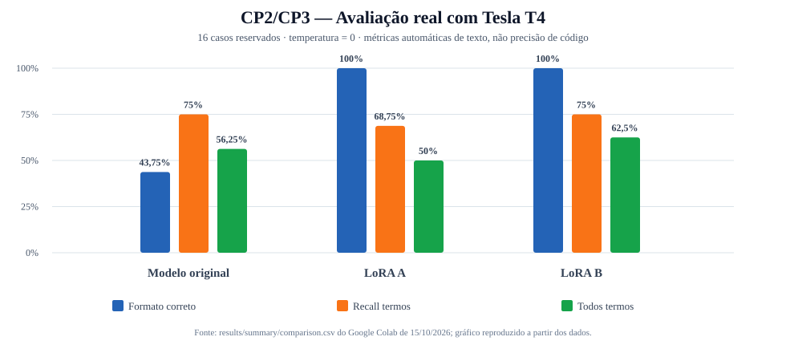
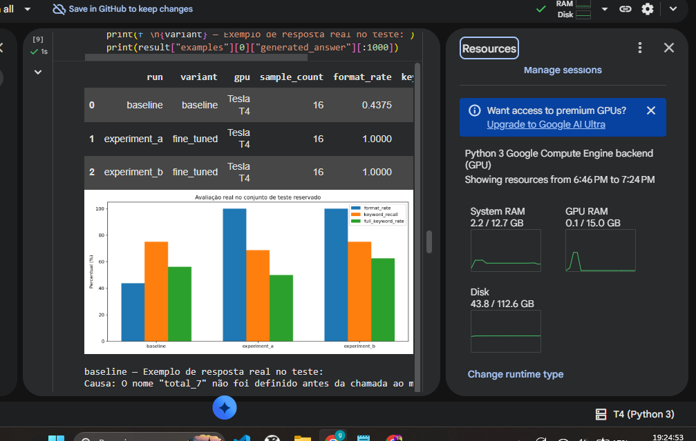
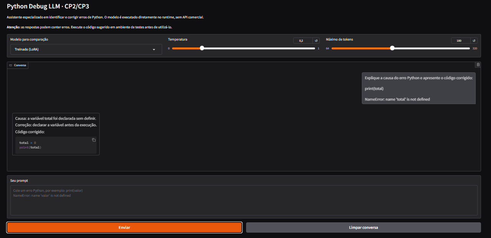

# CP2 / CP3 — Generative AI for Engineering

**Projeto:** Python Debug LLM — Assistente de diagnóstico e correção de erros em Python

**Disciplina:** Generative AI for Engineering  |  **Entrega:** 15/10/2026, 23h59  |  **Turma: 4ESPX**  |  **Grupo:** 5 integrantes

> **Status atualizado em 15/10/2026:** fine-tuning LoRA A/B, baseline e inferências **executados realmente na GPU Tesla T4 do Google Colab**; métricas e gráfico publicados em `evidences/`. Nove capturas reais (incluindo gráfico original) do navegador Colab/Gradio foram **publicadas no GitHub**, em `evidences/screenshots/`. **A captura da GPU dentro do VS Code ainda não foi enviada.** Não há métricas fictícias.

## Execute o projeto no Google Colab (GPU gratuita)

**[ABRIR NOTEBOOK NO GOOGLE COLAB](https://colab.research.google.com/github/GuilhermeSSantos2004/GenerativeAI-Engineering/blob/main/notebooks/CP2_CP3_Colab.ipynb)**

1. Acesse o link acima com sua conta Google.
2. Em **Ambiente de execução > Alterar tipo de ambiente de execução**, escolha **GPU** (se disponível).
3. Execute as células do notebook **na ordem**. A primeira célula verifica se CUDA está funcionando.
4. O notebook clona o código, instala dependências, testa dataset, avalia baseline, executa 2 fine-tunings LoRA e compara resultados.
5. Ao final, exporte evidências, salve o ZIP contendo adapters/resultados e tire os prints reais da GPU no VS Code e do frontend.

**Atenção:** GPUs no Colab Free não são garantidas. Não marque um treinamento como realizado antes de ver a execução e seus arquivos de saída. Fonte: [FAQ oficial do Colab](https://research.google.com/colaboratory/intl/pt-BR/faq.html).

## Problema de engenharia abordado

Durante o desenvolvimento, estudantes e profissionais encontram exceções como `NameError`, `TypeError`, `IndexError`, `KeyError` e `ZeroDivisionError`. A LLM recebe um trecho de código e o erro exibido, identifica a causa e apresenta uma correção concreta em português.

**Exemplo de entrada**

~~~text
Explique este erro e corrija:
print(total)
NameError: name 'total' is not defined
~~~

**Formato de resposta esperado**

~~~text
Causa: a variável total foi utilizada antes de ser definida.
Correção: inicialize a variável antes de utilizá-la.
Código corrigido:
total = 10
print(total)
~~~

## Modelo e stack

| Componente | Escolha | Justificativa |
|---|---|---|
| LLM | [Qwen2.5-0.5B-Instruct](https://huggingface.co/Qwen/Qwen2.5-0.5B-Instruct) | Modelo aberto e compacto para runtime GPU gratuito |
| Ajuste fino | PEFT + LoRA | Treina poucos parâmetros adicionais em vez de todos os pesos |
| Engine | PyTorch + Transformers | Inferência e treino reais, sem APIs proprietárias |
| Plataforma GPU | Google Colab Free | Permite testar em runtime com CUDA quando disponível |
| Frontend | Gradio | Chat com campo para prompts e seleção baseline/LoRA |
| Avaliação | Scripts próprios + JSON/CSV/PNG | Resultados reproduzíveis e auditáveis |
| Qualidade | unittest/pytest + GitHub Actions | Verifica integridade e sintaxe, sem simular treino GPU |

**LLM executada localmente no runtime:** modelo com pesos abertos carregado diretamente no processo Python da máquina que possui GPU. Não é uma API remota de terceiros. No Colab, a máquina é hospedada na nuvem do Google — não no notebook pessoal do aluno.

## Dataset e divisão

| Arquivo | Registros | Objetivo |
|---|---:|---|
| `data/train.jsonl` | 96 | Treinar o adapter LoRA |
| `data/val.jsonl` | 16 | Selecionar/validar checkpoints |
| `data/test.jsonl` | 16 | Medir respostas das três variantes |

**Total: 128 exemplos sintéticos**, cobrindo 16 padrões de erros Python. Os prompts e IDs não se repetem entre splits. Como os exemplos compartilham padrões, os resultados não demonstram capacidade generalista em códigos desconhecidos. Veja [Metodologia](docs/METODOLOGIA.md).

## Plano dos experimentos

| Variante | Learning rate | Épocas | LoRA r | Batch | GPU |
|---|---:|---:|---:|---:|---|
| Original (baseline) | — | — | — | — | CUDA obrigatória |
| A | 0.0002 | 2 | 8 | 2 | CUDA obrigatória |
| B | 0.00005 | 3 | 16 | 2 | CUDA obrigatória |

Avaliação com temperatura `0` para reduzir aleatoriedade. Métricas: taxa do formato esperado, recuperação de palavras-chave, taxa de acerto de todos os termos e latência. São **métricas auxiliares**, não substituem análise qualitativa das respostas.

## Executar no terminal (ambiente CUDA)

~~~bash
python -m pip install -r requirements.txt
python -m pytest -q tests
python scripts/check_gpu.py --output results/gpu.json
python -m src.evaluate --output results/baseline.json
python -m src.train --output-dir outputs/experiment_a --learning-rate 0.0002 --epochs 2 --lora-r 8
python -m src.evaluate --adapter outputs/experiment_a/final_adapter --output results/experiment_a.json
python -m src.train --output-dir outputs/experiment_b --learning-rate 0.00005 --epochs 3 --lora-r 16
python -m src.evaluate --adapter outputs/experiment_b/final_adapter --output results/experiment_b.json
python -m src.report --inputs results/baseline.json results/experiment_a.json results/experiment_b.json
python scripts/export_evidence.py --strict
python scripts/build_markdown_report.py
python -m src.ui --adapter outputs/experiment_a/final_adapter --share
~~~

`--share` é para o Colab, gera uma URL temporária pública (não use prompts confidenciais). Em ambiente local remova `--share` e acesse `http://localhost:7860`.

## Estrutura do repositório

~~~text
GenerativeAI-Engineering/
├── notebooks/CP2_CP3_Colab.ipynb     # Roteiro principal executável
├── data/{train,val,test}.jsonl      # Base sintética versionada
├── src/
│   ├── common.py                   # Prompt, dataset e inferência
│   ├── train.py                    # Fine-tuning LoRA na GPU
│   ├── evaluate.py                 # Baseline e adapters em teste
│   ├── report.py                   # Gráfico e tabela comparativos
│   └── ui.py                       # Chat Gradio
├── scripts/
│   ├── check_gpu.py                # GPU e CUDA reais
│   ├── export_evidence.py          # Cópia de resultados reais
│   └── build_markdown_report.py    # Relatório com medições reais
├── tests/test_project.py           # Testes automáticos dos dados
├── docs/                           # Metodologia, execução, entrega, grupo
├── evidences/                      # Resultados e prints após a execução
├── .github/workflows/quality.yml   # Integração contínua (CPU)
└── requirements.txt
~~~

## Resultados verificados do treinamento na Tesla T4 (15/10/2026)

| Indicador | Modelo original | LoRA A | LoRA B |
|---|---:|---:|---:|
| Formato com as três seções solicitadas | 43,75% | 100% | 100% |
| Recall de palavras-chave | 75% | 68,75% | 75% |
| Todas as palavras-chave | 56,25% | 50% | 62,5% |

**Limitações:** os valores representam métricas textuais auxiliares calculadas sobre **16 testes sintéticos reservados**, não acerto semântico. As capturas Gradio também identificaram correções incorretas em certos casos (especialmente IndexError). [Análise técnica e erros observados](docs/RESULTADOS_REAIS.md) · [GPU real](evidences/gpu.json) · [Métricas por teste](evidences/per_case_scores.csv) · [Treinamento A](evidences/experiment_a_training.json) · [Treinamento B](evidences/experiment_b_training.json).

## Capturas reais de execução e frontend

As **9 imagens PNG originais** enviadas pelo grupo estão organizadas em [evidences/screenshots/](evidences/screenshots/) e descritas no [índice das evidências](evidences/README.md). Algumas correções sugeridas pela LLM são imperfeitas; isso está documentado na avaliação qualitativa.

| Execução dos experimentos em GPU Tesla T4 | Frontend Gradio com prompt e resposta |
|---|---|
|  |  |

Também existem prints dos treinamentos A/B concluídos, dos erros IndexError, ZeroDivisionError e ValueError, e de um teste complementar.

**Pendência literal do enunciado:** a captura da GPU **dentro do VS Code** ainda não foi apresentada. Os prints com Colab aberto no navegador demonstram GPU, mas não substituem esse requisito.

## Correspondência com os itens da atividade

| Exigência | Arquivo/solução | Situação |
|---|---|---|
| Selecionar LLM | Qwen2.5-0.5B-Instruct | Definido |
| Resolver problema específico | Diagnóstico de erros Python | Definido |
| Treinar localmente a LLM | `src/train.py` e notebook Colab | **Executado** na Tesla T4; métricas disponíveis |
| Testar diferentes parâmetros | Experimentos A/B | **Executados**, parâmetros e losses registrados |
| Avaliar respostas | `src/evaluate.py`, `src/report.py` | **Executado** em 16 testes; erros qualitativos reconhecidos |
| Realizar testes usando GPU | `scripts/check_gpu.py`, verificações CUDA | **Executado** na T4; `evidences/gpu.json` |
| Criar frontend para prompts | `src/ui.py` (Gradio) | **Executado**; screenshots originais publicados em `evidences/screenshots/` |
| Capturar GPU no VS Code | [Guia de execução](docs/EXECUCAO.md) | Pendente de print real |
| Documentar código no GitHub | README, docs, fontes, notebooks e dataset | **Publicado, incluindo os nove PNGs e JSONs detalhados** |
| Grupo 4–5 pessoas | [Integrantes confirmados](docs/GRUPO.md) | **5 pessoas confirmadas, turma 4ESPX** |

## Documentação e evidências

- [Como executar no Colab e no VS Code](docs/EXECUCAO.md)
- [Metodologia e limitações](docs/METODOLOGIA.md)
- [Resultados reais da Tesla T4 e auditoria das respostas](docs/RESULTADOS_REAIS.md)
- [Checklist de entrega](docs/ENTREGA.md)
- [Integrantes (verificar)](docs/GRUPO.md)
- [Evidências e resultados](evidences/README.md)

Os nove prints originais, todas as 48 respostas de avaliação em JSON, métricas, históricos de treino e gráficos de loss já estão publicados. Resta especificamente a captura solicitada **dentro do VS Code**. **Não invente outputs ou estatísticas.**
