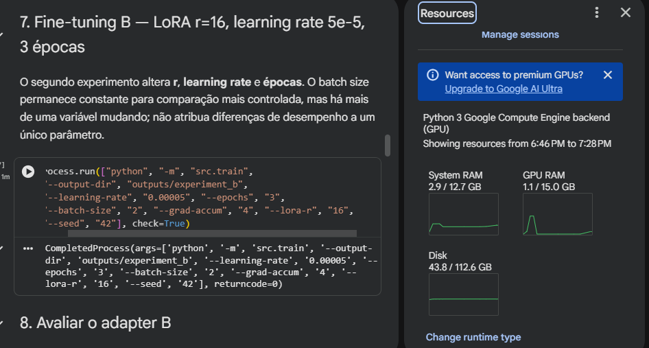

# Evidências do CP2/CP3 — turma 4ESPX

## Dados de execução GPU já publicados neste GitHub

- [gpu.json](gpu.json): identificação real da Tesla T4, CUDA e PyTorch.
- [experiment_a_training.json](experiment_a_training.json): hiperparâmetros e perdas reais do fine-tuning A.
- [experiment_b_training.json](experiment_b_training.json): hiperparâmetros e perdas reais do fine-tuning B.
- [comparison.csv](comparison.csv): métricas do baseline, LoRA A e LoRA B sobre os 16 testes.
- [comparison.svg](comparison.svg): gráfico refeito com os dados reais do CSV.
- [baseline.json](baseline.json), [experiment_a.json](experiment_a.json), [experiment_b.json](experiment_b.json): as **48 respostas geradas**, com prompts, saídas e avaliações no conjunto reservado.
- [loss_experiment_a.png](loss_experiment_a.png), [loss_experiment_b.png](loss_experiment_b.png): gráficos originais da loss de treinamento e validação.
- [RELATORIO_EXECUCAO.md](RELATORIO_EXECUCAO.md): relatório exportado do notebook com métricas reais.

A análise das saídas do ZIP está registrada em [docs/RESULTADOS_REAIS.md](../docs/RESULTADOS_REAIS.md). Não confunda métricas automáticas baseadas em palavras-chave com taxa de acertos de código.

## Capturas reais publicadas e verificadas no GitHub

O estudante enviou os seguintes prints em 15/10/2026 e os nove arquivos PNG **originais** foram publicados em [`evidences/screenshots/`](screenshots/) nos commits [`0a219b1`](https://github.com/GuilhermeSSantos2004/GenerativeAI-Engineering/commit/0a219b14d44284f2505dfc754eb241b1016ec0ab) e [`cf79975`](https://github.com/GuilhermeSSantos2004/GenerativeAI-Engineering/commit/cf79975c34b5d8929bb79d5b53f0fa54cfc573f8). Os arquivos foram conferidos diretamente na API do GitHub, com o mesmo tamanho em bytes do arquivo recebido:

| Arquivo | Conteúdo | Análise |
|---|---|---|
| `screenshots/01_colab_comparacao_e_gpu_t4.png` | Comparação dos três modelos e painel T4 no navegador | Suporta uso da GPU e métricas |
| `screenshots/02_frontend_nameerror.png` | Gradio: NameError com solução executável | Resposta coerente |
| `screenshots/03_frontend_indexerror_correcao_incorreta.png` | Gradio: IndexError | Diagnóstico correto, código sugerido usa `números` e `numeros` de forma inconsistente |
| `screenshots/04_frontend_zero_division.png` | Gradio: ZeroDivisionError | Verificação do divisor |
| `screenshots/05_frontend_valueerror_resposta_parcial.png` | Gradio: ValueError | Código de saída muda literal; explicação é imprecisa |
| `screenshots/06_treinamento_lora_A_t4.png` | Treinamento A finalizado, Tesla T4 no painel | Returncode 0 |
| `screenshots/07_treinamento_lora_B_t4.png` | Treinamento B finalizado, Tesla T4 no painel | Returncode 0 |
| `screenshots/08_frontend_prompt_adicional.png` | Teste complementar no Gradio | Demonstra interface em operação |
| `screenshots/09_grafico_comparacao_original.png` | Gráfico comparativo original | Figura produzida na avaliação Colab |
| [`screenshots/10_gpu_vscode_tesla_t4.webp`](screenshots/10_gpu_vscode_tesla_t4.webp) | Captura REAL do notebook aberto no VS Code, com GPU Tesla T4, CUDA disponível True e VRAM | Evidência final solicitada pelo professor; imagem original convertida para WebP **lossless**, sem alteração de conteúdo |

**Conferência:** os nove arquivos PNG e a captura adicional do VS Code em formato WebP sem perdas estão disponíveis no GitHub. Os screenshots do navegador não foram rotulados como capturas do VS Code; a imagem 10 é a captura verdadeira do editor.

## Pendências frente ao professor

- [x] Treino LoRA A e B em GPU Tesla T4, arquivos de métricas reais.
- [x] Comparação do modelo original com os fine-tunings.
- [x] Frontend Gradio com respostas registradas em prints.
- [x] Grupo de 5 integrantes, turma 4ESPX, em `docs/GRUPO.md`.
- [x] **Print da GPU efetivamente dentro do VS Code**: [`10_gpu_vscode_tesla_t4.webp`](screenshots/10_gpu_vscode_tesla_t4.webp), com CUDA True, Tesla T4, 14.56 GiB de VRAM e tensor `cuda:0`. A GPU executada no editor é remota (Google Colab), não um componente físico do notebook.
- [x] Publicar os nove PNGs originais em `screenshots/`.
- [x] Publicar os JSON detalhados das 16 respostas por variante (`baseline.json`, `experiment_a.json`, `experiment_b.json`).
- [x] Publicar os históricos dos experimentos, relatório de execução e gráficos de loss originais.

## Galeria visual dos prints enviados

**Captura no VS Code (requisito específico):**

**Nota de integridade:** o print 10 é verdadeiramente do VS Code e os demais são do navegador Colab/Gradio. Não publicar pesos-base do modelo nem tratar a GPU remota como placa instalada no computador físico.
