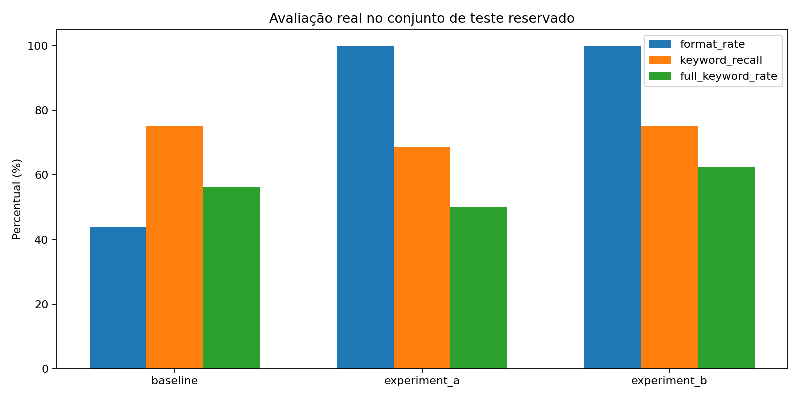

# Resultados e evidências — CP2/CP3

Esta pasta reúne os resultados obtidos na execução do **Python Debug LLM**, realizada com a GPU Tesla T4 do Google Colab.

## GPU no VS Code

[Ver a imagem original em tamanho completo](screenshots/10_gpu_vscode_tesla_t4.webp)

O notebook exibiu `CUDA disponível: True`, `GPU: Tesla T4`, **14,56 GiB de VRAM** e tensor no dispositivo `cuda:0`. A GPU usada era remota, conectada ao VS Code pelo ambiente do Colab.

## Treinamentos e avaliação

| Arquivo | Conteúdo |
|---|---|
| [gpu.json](gpu.json) | Identificação da GPU, versões PyTorch/CUDA e memória |
| [experiment_a_training.json](experiment_a_training.json) | Hiperparâmetros, duração e perdas do treinamento A |
| [experiment_b_training.json](experiment_b_training.json) | Hiperparâmetros, duração e perdas do treinamento B |
| [experiment_a_history.json](experiment_a_history.json) | Histórico das etapas de treinamento A |
| [experiment_b_history.json](experiment_b_history.json) | Histórico das etapas de treinamento B |
| [baseline.json](baseline.json) | Prompts, respostas e métricas do modelo original |
| [experiment_a.json](experiment_a.json) | Respostas e métricas após o treinamento A |
| [experiment_b.json](experiment_b.json) | Respostas e métricas após o treinamento B |
| [comparison.csv](comparison.csv) | Comparação numérica entre os três modelos |
| [comparison.svg](comparison.svg) | Gráfico consolidado das métricas |
| [loss_experiment_a.png](loss_experiment_a.png) | Curvas de loss do treinamento A |
| [loss_experiment_b.png](loss_experiment_b.png) | Curvas de loss do treinamento B |
| [RELATORIO_EXECUCAO.md](RELATORIO_EXECUCAO.md) | Relatório gerado a partir dos resultados |

Foram avaliadas **16 perguntas por variante** (48 respostas no total), com as mesmas entradas de teste. O ajuste fino melhorou a consistência do formato das respostas, mas nem todas as correções de código ficaram certas. A análise de exemplos está em [Resultados reais](../docs/RESULTADOS_REAIS.md).

## Capturas de tela

| Arquivo | Registro |
|---|---|
| [10_gpu_vscode_tesla_t4.webp](screenshots/10_gpu_vscode_tesla_t4.webp) | Tesla T4, CUDA e alocação de tensor no VS Code |
| [01_colab_comparacao_e_gpu_t4.png](screenshots/01_colab_comparacao_e_gpu_t4.png) | Comparação dos modelos no Colab e monitoramento da GPU |
| [06_treinamento_lora_A_t4.png](screenshots/06_treinamento_lora_A_t4.png) | Execução do fine-tuning A |
| [07_treinamento_lora_B_t4.png](screenshots/07_treinamento_lora_B_t4.png) | Execução do fine-tuning B |
| [09_grafico_comparacao_original.png](screenshots/09_grafico_comparacao_original.png) | Gráfico original da comparação |
| [02_frontend_nameerror.png](screenshots/02_frontend_nameerror.png) | Teste do Gradio com NameError |
| [03_frontend_indexerror_correcao_incorreta.png](screenshots/03_frontend_indexerror_correcao_incorreta.png) | Teste com IndexError; exemplo de correção inadequada |
| [04_frontend_zero_division.png](screenshots/04_frontend_zero_division.png) | Teste com ZeroDivisionError |
| [05_frontend_valueerror_resposta_parcial.png](screenshots/05_frontend_valueerror_resposta_parcial.png) | Teste com ValueError |
| [08_frontend_prompt_adicional.png](screenshots/08_frontend_prompt_adicional.png) | Teste complementar no Gradio |

### Interface e treinamento

| Aplicação Gradio | Comparação dos modelos |
|---|---|
|  |  |

Os adaptadores LoRA foram exportados à parte no ZIP de resultados dos experimentos; os arquivos de pesos não fazem parte desta pasta.
